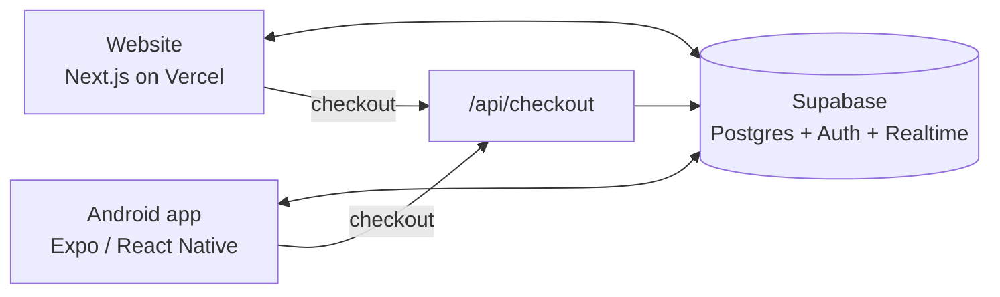

# Noire Liine: shop website and mobile app

An online shop for Nigerian fashion (Ankara, Adire, Agbada, Aso-oke and more) with a **website** and an **Android app** that share **one account and one live cart**. Add something to your cart on the website and it appears in the app straight away, and the other way round.

Built as a bootcamp project (Stage 3 of a series: Stage 2 was the website, Stage 3 adds the mobile app).

## Live links

| What | Link |
| --- | --- |
| **Website** | https://noire-liine.vercel.app |
| **Android app (APK download)** | https://expo.dev/artifacts/eas/dM_3hY715wjcA3P7e9Amv2mn2d6-LlPpRIASw2H_SLU.apk |
| **App build page** | https://expo.dev/accounts/rabbi_manuel/projects/mobile/builds/2a32c42a-59f6-4fd2-b209-abc6ffeec27c |
| **Source code** | https://github.com/Emperormanuel/noire-liine-mobile |
| Earlier version (Stage 2, website only) | https://github.com/Emperormanuel/noire-liine |

**Installing the app:** open the APK link on an Android phone, download the file and open it. Android will ask you to allow installs from your browser. Choose to allow, then install. Google Play Protect may warn that the app is unknown, because it is not from the Play Store. Choose "Install anyway".

> Expo keeps build files for a limited time. If the APK link has expired, rebuild it with the steps in [docs/SETUP.md](docs/SETUP.md).

## What the task required, and where it stands

| Requirement | Status |
| --- | --- |
| Log in to the website and the app with the same account | Done. Google sign-in through Supabase Auth on both |
| An item added on the website appears **instantly** in the app cart | Done. Supabase Realtime pushes the change to the app |
| Use the same API endpoints as the website | Done. Same Supabase project and the same `/api/checkout` route |
| Test on a physical phone | Done. See [docs/TESTING.md](docs/TESTING.md) |

## Features

**Website:** shop with categories, search and price sorting; prices in naira; a cart that saves to your account; checkout that stores orders; Google sign-in; order history; confirmation emails through Mailgun; privacy policy page.

**Mobile app:** product browsing with search and categories; the live shared cart with a "Synced live" indicator; checkout through the website's API; order history; Google sign-in.

## How it works in one minute



1. Both apps sign in through the same Supabase Auth project, so a person is one user everywhere.
2. The cart is a database table (`cart_items`) protected by Row Level Security, so each user can only see their own.
3. Both apps listen to that table through Realtime. When a row changes, every signed-in device updates.
4. Checkout goes through one API route that rechecks prices on the server, creates the order, and sends the email. The website authenticates with cookies and the app with a bearer token.

More detail in [docs/ARCHITECTURE.md](docs/ARCHITECTURE.md).

## Tech stack

| Part | Tool |
| --- | --- |
| Website | Next.js 15 (App Router), React 19 |
| Mobile app | Expo SDK 57, React Native 0.86 |
| Database, auth, realtime | Supabase (Postgres, Row Level Security, Realtime) |
| Login | Google OAuth through Supabase |
| Email | Mailgun HTTP API |
| Hosting | Vercel (website), Expo EAS Build (Android APK) |

## Repository layout

```
website/    The Next.js shop, with the database-backed cart
mobile/     The Expo / React Native app
docs/       Architecture, setup, testing and the case study
```

## Documentation

| Document | What is in it |
| --- | --- |
| [docs/ARCHITECTURE.md](docs/ARCHITECTURE.md) | Diagrams, data model, live sync, security model |
| [docs/SETUP.md](docs/SETUP.md) | Run locally, deploy the website, build the APK, troubleshooting |
| [docs/TESTING.md](docs/TESTING.md) | What was tested on a real phone and the results |
| [docs/CASE-STUDY.md](docs/CASE-STUDY.md) | Decisions, the problems met along the way and how they were solved |

## Security notes

- Row Level Security protects every table. The Supabase publishable (anon) key in the app is meant to be public.
- Server secrets (Mailgun key) are environment variables and are **not** in this repository. `.env` files are ignored by Git.
- Checkout ignores prices sent by the client and reads them from the database.
- This is a demo shop: **no real payment is taken**.

## Known limitations

- Android only. An iPhone build needs a paid Apple developer account.
- Mailgun's sandbox only delivers to authorised email addresses.
- Mobile sign-in currently uses the plain PKCE fallback because the phone lacks the Web Crypto API. Adding a polyfill is listed as a next step.

## Author

Emmanuel ([@Emperormanuel](https://github.com/Emperormanuel))
