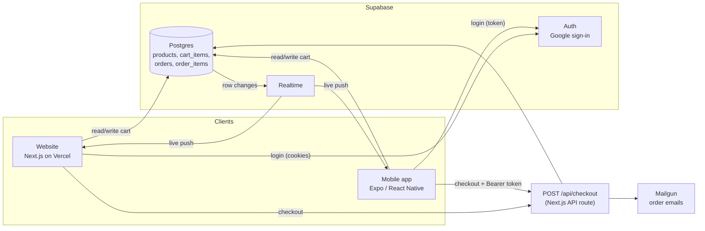
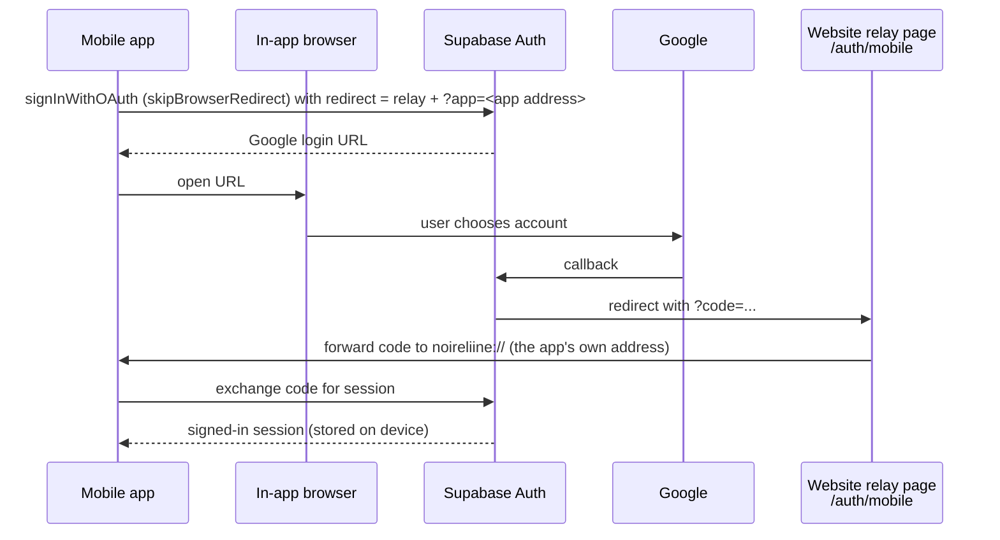

# Architecture

## Big picture

One Supabase project is the single source of truth. The website and the mobile app are two different front ends for the same data.



## Why the cart lives in the database

Stage 2 kept the cart in the browser's `localStorage`. That storage belongs to one browser on one device, so a phone could never see it. The cart is now the `cart_items` table:

| Column | Meaning |
| --- | --- |
| `user_id` | The owner (defaults to `auth.uid()`) |
| `product_id` | The product |
| `quantity` | 1 to 99 |
| `updated_at` | Used for ordering |

The primary key is `(user_id, product_id)`, so adding the same product again is an update, not a duplicate row.

## Live sync

Both apps subscribe to Supabase Realtime for changes on `cart_items` filtered to the signed-in user (`user_id=eq.<id>`). When any device changes a row, Supabase pushes an event, and every other device reloads its cart. The mobile cart screen shows a "Synced live" indicator while the subscription is active.

The `cart_items` table uses `REPLICA IDENTITY FULL` so that delete events also carry `user_id` and can be filtered correctly.

## Security model

- **Row Level Security** is on for every table. Cart rows can only be read, inserted, updated or deleted by their owner (`auth.uid() = user_id`). Orders are visible only to their owner. Products are public read-only.
- **Prices are never trusted from a client.** `/api/checkout` re-reads prices from the `products` table and rejects invalid quantities.
- **Two ways to prove who you are to the API:** the website sends session cookies. The app sends `Authorization: Bearer <access token>`. The route accepts both and validates the token with Supabase before doing anything.
- **Secrets:** the Supabase publishable (anon) key is designed to be public, because Row Level Security protects the data. The Mailgun key and any service-role key live only in server environment variables and are never in this repository.

## Sign-in flow on mobile



The relay page exists because Supabase trusts return addresses on the same site as its configured Site URL. See `CASE-STUDY.md` for the story behind it.

## Folder map

```
.
├── website/                Next.js 15 shop (Stage 2 + shared cart)
│   ├── app/                Pages and API routes
│   │   ├── api/checkout/   Order creation (cookie or Bearer token)
│   │   └── auth/mobile/    Relay page for the app's Google sign-in
│   ├── lib/cart.js         Database-backed cart with Realtime
│   └── supabase/           All SQL, including migration-cart.sql
├── mobile/                 Expo / React Native app
│   ├── lib/                Supabase client, auth, cart, theme
│   ├── screens/            Shop, Cart, Orders, Account
│   └── eas.json            Android APK build profile
└── docs/                   This documentation
```
